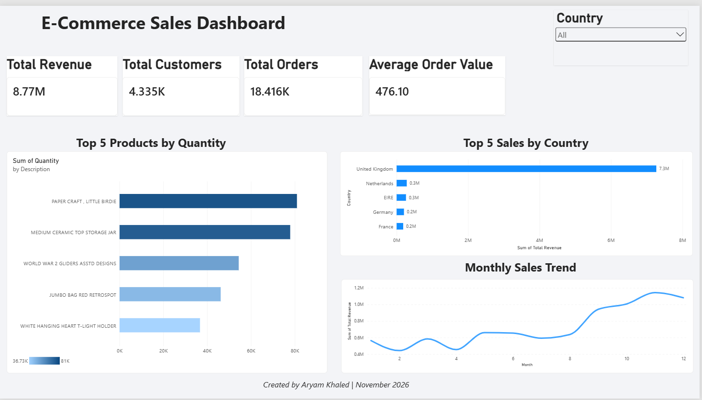

#  E-Commerce Sales Dashboard (Power BI) 📊

**Author:** Aryam Khaled  
**Date:** November 2026  
**Repository:** [Your GitHub Link]

---

## Project Overview

An interactive Power BI Dashboard built to analyze the UCI Online Retail Dataset. It provides a comprehensive view of sales performance, customer behavior, and geographic trends.

---

## Tools Used

- **Power BI Desktop**
- **Power Query** (Data Cleaning)
- **DAX** (Data Analysis Expressions for KPIs)

---

## Key Metrics (KPIs)

- **Total Revenue:** £8.77M
- **Total Customers:** 4,335
- **Total Orders:** 18,416
- **Average Order Value (AOV):** £476.10

---

## Dashboard Features

1. **Top 5 Products by Quantity:** Identifies the most sold products.
2. **Top 5 Sales by Country:** Highlights the geographic distribution (UK dominates).
3. **Monthly Sales Trend:** Tracks revenue patterns over 12 months.
4. **Interactive Filter:** A country filter allows users to drill down into specific markets.

---

## Dashboard Preview

---

## Dataset

- **Source:** UCI Online Retail Dataset
- **Size:** 541,909 transactions
- **Period:** December 2010 – December 2011